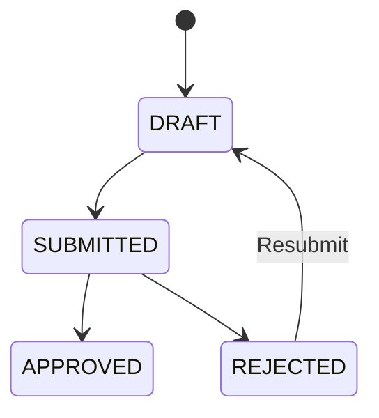
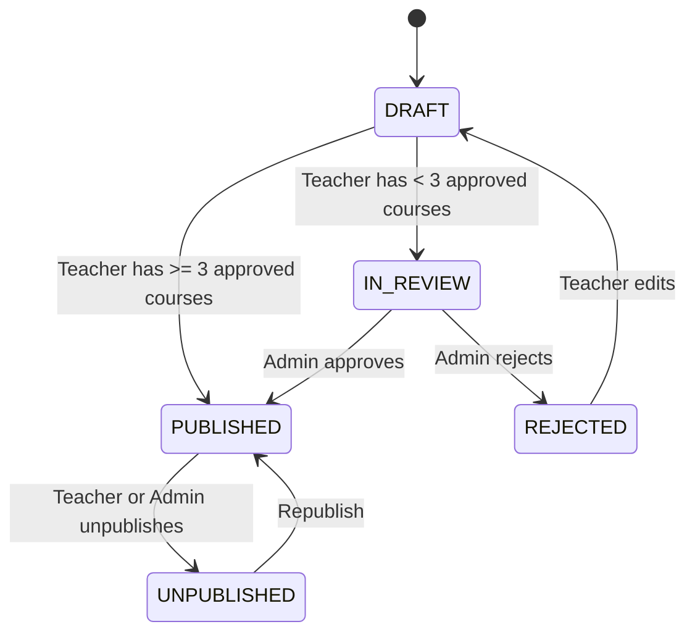
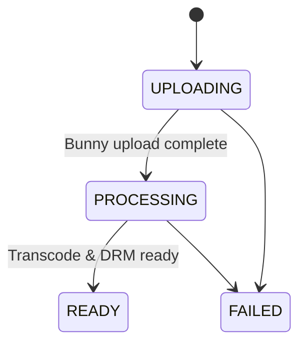
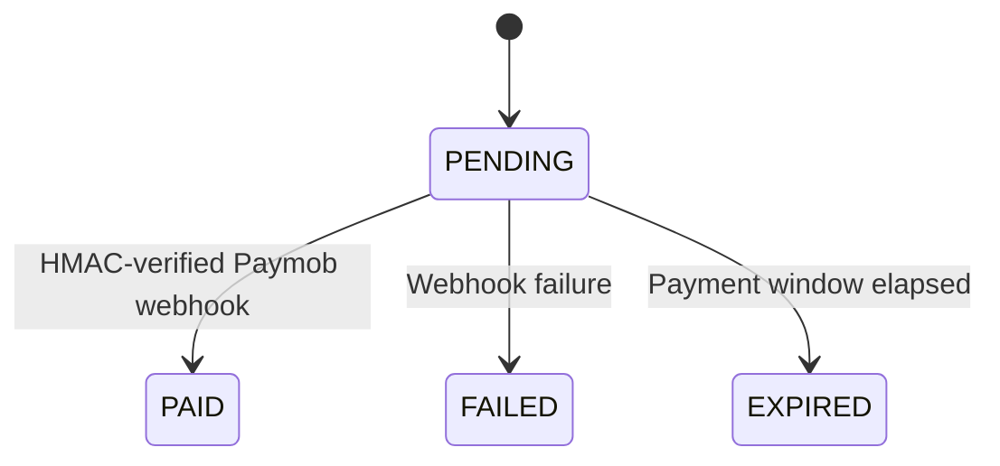
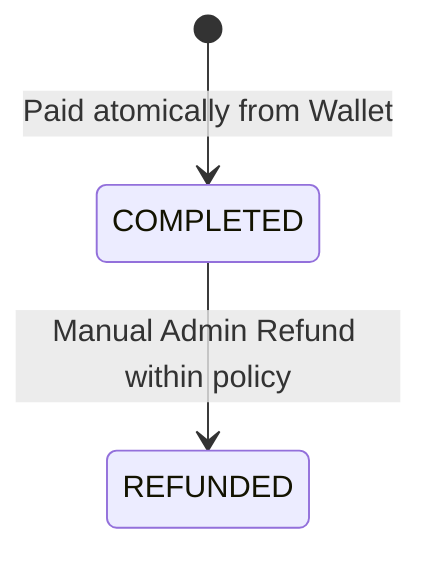
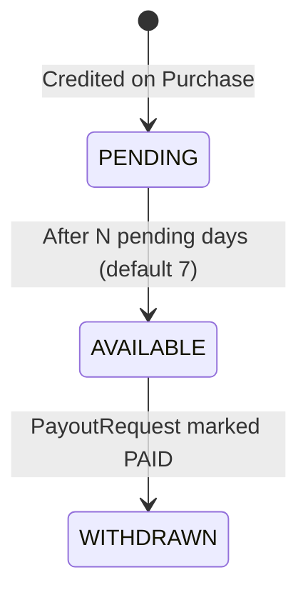
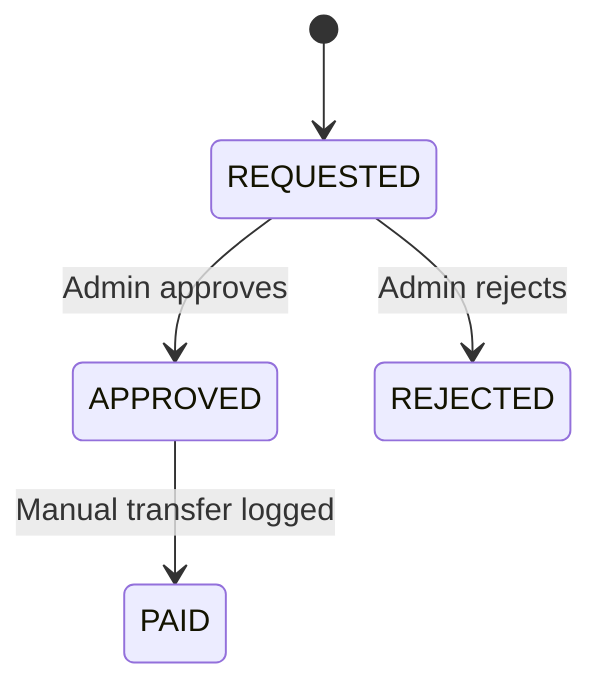
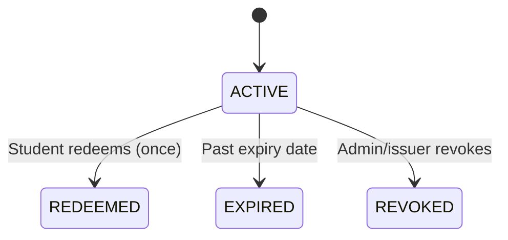

# Ma3afer (معافر) — Product & Technical Specification

> **Canonical vocabulary**: [GLOSSARY.md](../GLOSSARY.md)
> **Architecture Decision Records**: [ADR-0001](./adr/0001-marketplace-business-model.md) · [ADR-0002](./adr/0002-google-auth-and-deferred-whatsapp-otp.md) · [ADR-0003](./adr/0003-double-entry-wallet-ledger.md) · [ADR-0004](./adr/0004-bunny-stream-and-storage.md) · [ADR-0005](./adr/0005-multi-cloud-credit-hosting-split.md)

---

## 1. Overview & Product Vision

**Ma3afer (معافر)** is a full-stack online learning marketplace built specifically for the **Egyptian General Secondary Stage (الثانوية العامة)** across all three grades (1st, 2nd, and 3rd Secondary).

Independent teachers apply to join the platform, publish recorded video lectures, PDF attachments, and auto-graded quizzes organized into Courses, and sell access per individual **Lecture (محاضرة)** or teacher-defined **Package (باقة)**. Students browse public teacher profiles and free previews, fund an internal EGP **Wallet** via Paymob or prepaid **Recharge Codes**, and study with layered anti-piracy controls tailored to the Egyptian EdTech market.

### Naming & Domains

- **Brand name**: معافر
- **Codebase / internal identifier**: `ma3afer`
- **Production domain**: `mo3afer.com` (registered via Cloudflare Registrar)
  - Web application: `https://mo3afer.com`
  - API: `https://api.mo3afer.com`
  - Staging environment: `https://staging.mo3afer.com`
- **Future domain**: `ma3afer.com.eg` (after Egyptian company registration, useful for trust and payment gateway KYC)

### Localization & Target Platform

- **Language & Direction**: Arabic only at launch, built **RTL-first**. All UI copy lives behind an i18n layer so English can be added later without refactoring components.
- **Platforms (MVP)**: Responsive, mobile-first **Progressive Web App (PWA)**. Native mobile apps (Phase 2) will reuse the same REST API.

---

## 2. Academic Scope & Catalog

- **Covered system**: Egyptian **General Secondary (الثانوية العامة)** only — 1st, 2nd, and 3rd Secondary (`Grade`).
- **Tracks (`Track`)**: Supports traditional Thanaweya Amma tracks (`علمي علوم`, `علمي رياضة`, `أدبي`) as well as the new **Baccalaureate** system.
- **Subject Mapping (`SubjectOffering`)**: Subjects are mapped to specific `Grade + Track` pairs (managed by Admins), determining which subjects appear to a Student during discovery.
- **Academic Year (`Academic Year`)**: Every Course belongs to a specific `academicYear` (e.g., `2026/2027`). Teachers can **clone a Course** (structure and items) to a new academic year to roll over content smoothly.
- **Excluded from MVP**: Azhar secondary and technical secondary (may be added later via the same catalog model).

---

## 3. User Roles & Permissions

### MVP Roles

| Role | Capabilities |
|---|---|
| **Student** | Browse catalog & public teacher profiles, watch Free Previews, complete onboarding, verify phone via WhatsApp OTP, top up Wallet (Paymob or Recharge Code), redeem Content Codes, purchase Lectures & Packages, watch protected videos, download signed PDFs, take Quizzes, track progress, post Lecture Q&A questions, manage Registered Devices (self-remove 1 per 30 days). |
| **Teacher** | Apply via Teacher Application, receive Teaching Permissions, create/edit/clone Courses, Sections, Lectures, Lecture Items, and Packages, upload videos/PDFs directly to Bunny, create Quizzes & Quiz Gates, generate Content Code batches, answer/hide Lecture Q&A, view sales/earnings/enrolled students/view counts/per-student progress & quiz results, submit Payout Requests. |
| **Admin** | Promoted Google accounts (by super-admin). Manage catalog (Grades, Tracks, Subjects, Subject Offerings), review Teacher Applications and grant Teaching Permissions, review initial Courses and unpublish any content at any time, manage users (search, suspend, reset Registered Devices, resolve phone conflicts), issue manual Wallet adjustments and Refunds, generate/export/revoke Recharge Code batches, approve/record Payout Requests, configure global/per-Teacher Platform Commission and Platform Settings. |

### Future Roles (Schema-Ready, Out of MVP)

- **Parent**: Linked via the `parentPhone` collected during Student onboarding; views child's progress and quiz scores.
- **Teacher Assistant**: Delegated by a Teacher to upload content and answer Lecture Q&A.

---

## 4. Authentication, Onboarding & Anti-Piracy

### 4.1 Sign-In & Sessions (ADR-0002)

- **Provider**: All roles sign in with **Google OAuth** in Phase 1.
- **Extensible identity model**: External credentials live in `AuthIdentity` (`provider`, `providerId`, `userId`), separate from `User`, allowing Phone OTP or email/password login to be added later without migrating existing accounts.
- **Session transport**: The API issues **httpOnly, Secure, SameSite** cookies shared across `mo3afer.com` and `api.mo3afer.com`:
  - Short-lived access token
  - Server-side `RefreshSession` bound to a `Device` record so sessions can be revoked individually or remotely.

### 4.2 Mandatory Onboarding

Immediately after first Google sign-in and before using authenticated features:
- **Student onboarding**: Full Arabic name, Egyptian mobile number (validated Egyptian format, stored with `phoneVerified = false`), parent mobile number (validated Egyptian format), Grade, Track, and Governorate.
- **Teacher onboarding**: Redirected to the `TeacherApplication` form.

### 4.3 Deferred WhatsApp OTP Verification (ADR-0002)

- **Trigger**: Required before a Student's **first monetary action** — first Wallet Top-Up, first Purchase, or first Recharge/Content Code redemption. Free Preview lectures do **not** require phone verification.
- **Channel**: **WhatsApp Cloud API** using an approved authentication message template.
- **Uniqueness invariant**: One **Verified Phone** maps to at most one Student account.
  - If a Student tries to verify a phone already verified on another account, verification is **blocked** and the Student is directed to support (no automatic transfer). Admins handle legitimate cases (e.g., siblings sharing a phone) manually.
- **Operational prerequisite**: Meta Business verification and WhatsApp authentication template approval must begin early in M0/M1 due to multi-day/week lead times.

### 4.4 Layered Anti-Piracy Controls (ADR-0004)

Because browser-based DRM is weaker than native in-app hardware DRM, piracy is deterred through five layers:

1. **Registered Device Limit (Students only; Teachers & Admins exempt)**:
   - Maximum **2 Registered Devices** per Student, identified by a browser-persisted device ID plus User-Agent and linked to `RefreshSession`.
   - Logging in on a 3rd device is **blocked** and presents a screen listing currently registered devices.
   - A Student may self-remove **1 device once every 30 days**; any additional device reset requires Admin intervention.
2. **Single Concurrent Playback Session**:
   - Maximum **1 active `PlaybackSession`** per Student account at a time across all Registered Devices.
   - Starting playback on Device B invalidates/stops active playback on Device A.
3. **Bunny Stream Protection**:
   - HLS streaming with **MediaCage DRM** and short-lived signed token authentication.
   - Paid PDFs hosted on **Bunny Storage + CDN** behind short-lived signed URLs.
4. **Dynamic Verified-Phone Watermark**:
   - Paid videos display a semi-transparent watermark showing the Student's **Verified Phone number only** (no student ID, keeping viewing unobtrusive), repositioning randomly every few seconds.
   - Free Previews carry no watermark.
5. **Post-Purchase Access & View Limits**:
   - Each Lecture or Package carries configurable **access expiry** (default: end of the Course's Academic Year) and **max views per Video** (default: `4`), set by the Teacher within Admin-defined bounds.
   - A view increments `VideoViewCount` once the Student watches approximately **70%** of the Video.

---

## 5. Core Domain Workflows & Business Rules

### 5.1 Teacher Application & Course Moderation

- **Application fields**: National ID document, requested Subject(s) and Grade(s), years of experience, sample teaching video, and phone number (verified manually by Admin during review).
- **Teaching Permissions**: Approving an application grants explicit `TeachingPermission` records (`teacher + subject + grade`). Teachers can hold multiple permissions; adding a new Subject or Grade later requires a separate Admin approval.
- **Course Review Threshold**:
  - A Teacher's **first 3 Courses** must pass Admin review (`IN_REVIEW → PUBLISHED`) before going public.
  - Once a Teacher has **3 approved Courses**, subsequent Courses publish immediately without review.
  - **New Lectures** added to an already-published Course publish immediately (avoiding mid-year bottlenecks).
  - Admins can unpublish any Course or Lecture at any time.

### 5.2 Content Hierarchy & Learning Experience

- **Hierarchy**: `Teacher` → `Course` (1 Subject + 1 Grade/Track + Academic Year) → `Section` (ordered) → `Lecture` (ordered, purchasable unit) → `LectureItem` (ordered: `Video`, `Attachment` [PDF], or `Quiz`).
- **Direct media uploads**: Teachers upload Videos directly from the browser to Bunny Stream and PDFs/images directly to Bunny Storage using API-issued upload credentials; media bytes never pass through `apps/api`.
- **Free Previews**: Teachers mark specific Lectures as free via an explicit `isFree` boolean (never by setting price to `0`). Free Previews are publicly watchable without payment, phone verification, or watermark.
- **Quizzes**:
  - Question types (MVP): single-choice MCQ and True/False.
  - Rich content: images in questions and options, **LaTeX/KaTeX** math rendering (critical for Physics, Math, Chemistry).
  - Settings: optional time limit, question shuffling, option shuffling, passing score percentage, and automatic grading stored in `QuizAttempt`.
- **Quiz Gating**: Optional per-Lecture flag set by the Teacher requiring the Student to achieve the passing score (e.g., ≥ 50%) on the Lecture's Quiz before the next Lecture unlocks.
- **Progress Tracking**: `LectureProgress` tracks video watch percentage, completion state, and quiz pass status.
- **Lecture Q&A**:
  - Enrolled Students can post `LectureQuestion`s on a Lecture.
  - Questions and answers are visible to **all Students enrolled in that Lecture** so the Teacher answers once for everyone.
  - Only the Lecture's Teacher (and later Assistants) can post `LectureAnswer`s.
  - The Teacher can hide any inappropriate question.
- **Public Discovery (SSR for SEO)**:
  - Browse by `Grade → Track → Subject → Teachers`, search by teacher/subject/course, public Teacher profile pages (bio, intro video, courses, Free Previews), and public Course landing pages.
  - Ratings and reviews are intentionally omitted from MVP to prevent early manipulation.

### 5.3 Pricing, Packages, Entitlements & Codes (ADR-0001, ADR-0003)

- **Currency & precision**: EGP only, stored strictly as integer **piasters** (e.g., `1000` = 10.00 EGP).
- **Price bounds**: Admins configure a global minimum price in `PlatformSetting` (e.g., `1000` piasters / 10 EGP) for paid Lectures and Packages. No maximum price. Free Lectures must use `isFree = true`.
- **Packages**:
  - A Teacher creates a `Package` within a Course by grouping specific Lectures under one price (commonly named by month, e.g., "باقة شهر نوفمبر").
  - **Live entitlement semantics**: Purchasing a Package creates an `Entitlement` to the **Package itself**, not a frozen copy of its lectures. Access check for a Lecture succeeds if the Student holds a valid direct Lecture Entitlement **OR** a valid Package Entitlement whose Package currently contains that Lecture.
  - Adding a new Lecture to a Package automatically grants access to existing Package buyers.
  - **Removing a Lecture** from a Package is **blocked** once the Package has at least one sale (permitted only when sales count is `0`).
  - **Overlap rule**: Buying a Package when the Student already owns some of its Lectures charges the full Package price and displays a clear warning listing the already-owned Lectures (no automatic overlap discounting in MVP).
- **Purchases**: Paid instantly and atomically from the Student's Wallet. Captures the effective `PlatformCommission` rate on the `Purchase` record at the moment of sale.
- **Online Wallet Top-Ups (Paymob)**:
  - Supports bank cards, Egyptian mobile wallets (Vodafone Cash, Etisalat Cash, Orange Cash, etc.), and Fawry/Aman kiosk reference codes.
  - Top-Up transitions to `PAID` and credits the Wallet **exclusively** via HMAC-verified Paymob webhook callbacks (idempotent on Paymob transaction ID).
- **Prepaid Recharge Codes (`RechargeCodeBatch` / `RechargeCode`)**:
  - Generated exclusively by Admins with fixed EGP value, quantity, and expiry date; exportable to CSV/PDF for offline printing.
  - Optionally tagged with a `teacherId` to track and attribute offline center sales.
  - Redeeming credits the Student's Wallet (requires Verified Phone).
- **Direct-Unlock Content Codes (`ContentCodeBatch` / `ContentCode`)**:
  - Generated by a Teacher for one of their own Lectures or Packages (sold offline in physical centers).
  - Because Ma3afer does not collect the cash from the Student, the platform's commission on the batch is charged to the Teacher **at batch generation time** (deducted from the Teacher's available earnings ledger or prepaid balance).
  - Redeeming directly grants an `Entitlement` to the target Lecture or Package without touching the Student's Wallet (requires Verified Phone).

### 5.4 Double-Entry Ledger, Earnings, Refunds & Payouts (ADR-0003)

- **Append-only ledger**: No balance column is updated directly. Every financial movement creates a balanced `LedgerTransaction` (sum of debits = sum of credits) with immutable `LedgerEntry` rows across typed `LedgerAccount`s:
  - `STUDENT_WALLET` (per Student)
  - `TEACHER_PENDING_EARNINGS` (per Teacher)
  - `TEACHER_AVAILABLE_EARNINGS` (per Teacher)
  - `PLATFORM_REVENUE` (system)
  - `PAYMOB_CLEARING` (system)
  - `RECHARGE_CODE_LIABILITY` (system)
  - `PAYOUT_CLEARING` (system)
- **Commission**: Global default percentage stored in `PlatformSetting`, overridable per Teacher by an Admin. Snapshotted on every `Purchase` and `ContentCodeBatch`.
- **Teacher Earnings settlement**:
  - Each Purchase credits the Teacher's net share to `TEACHER_PENDING_EARNINGS`.
  - After the configurable refund holding window (default **7 days** in `PlatformSetting`), a scheduled Postgres job (`pg-boss`) transfers settled earnings from `TEACHER_PENDING_EARNINGS` to `TEACHER_AVAILABLE_EARNINGS`.
- **Monthly Payouts**:
  - Teachers submit a `PayoutRequest` when available earnings meet the minimum withdrawal threshold.
  - Admins review, execute the real-world transfer manually (bank transfer, InstaPay, or mobile wallet), record the transfer reference, and mark the request `PAID` (debiting `TEACHER_AVAILABLE_EARNINGS`).
- **Refunds**:
  - No self-service refunds.
  - Admins can manually refund a `Purchase` within **3 days** of purchase if the Student has watched less than the configured threshold (`X%`) of the purchased content.
  - Refunds always credit the **Student's Wallet** (never back to a payment card), reverse the Teacher's pending earning and platform revenue, and revoke the `Entitlement`.
- **Receipts & Tax**: In-app purchase/top-up receipts only in MVP. Formal Egyptian e-invoicing (ETA) is deferred until company registration and accountant review.

### 5.5 Notifications

- **MVP Channels**: **In-app notifications** (`Notification` entity) + **Email** (sent to the user's verified Google email).
- **Trigger Events**:
  - New Lecture published in an enrolled Course
  - Teacher answered a Student's Lecture Q&A question
  - Teacher Application approved or rejected
  - Payout Request approved, paid, or rejected
  - Wallet Top-Up confirmed
- **Post-MVP Channels**: PWA Web Push (soon after MVP), WhatsApp notifications (Phase 2).

### 5.6 Dashboards

- **Teacher Dashboard (MVP)**:
  - Sales and earnings breakdown (`PENDING`, `AVAILABLE`, `WITHDRAWN`)
  - Enrolled students per Course and Package
  - Video view counts per Lecture
  - Quiz results per Student
  - **Per-Student progress & quiz report view** (enables teachers to share updates with parents manually until Parent accounts launch)
  - Content Code batch generator & status tracker
  - Payout Request submission and history
- **Admin Panel (MVP)**:
  - Hosted inside the same Next.js app under `/admin` with strict server- and client-side Admin role guards.
  - Modules: Teacher Application review, Course moderation queue, User management (search, suspend, **reset Registered Devices**, resolve phone uniqueness conflicts), manual Wallet adjustments & Refunds, Recharge Code batch generator & CSV/PDF exporter, Payout Request approval & transfer logging, global & per-Teacher Commission settings, `PlatformSetting` management, and Academic Catalog CRUD.

---

## 6. Domain Data Model

### Entity Map

| Bounded Area | Entities |
|---|---|
| **Catalog** | `Grade`, `Track`, `Subject`, `SubjectOffering` |
| **Identity & Security** | `User`, `AuthIdentity`, `StudentProfile`, `TeacherProfile`, `Device`, `RefreshSession`, `PhoneVerification`, `PlaybackSession` |
| **Teacher Onboarding** | `TeacherApplication`, `TeachingPermission` |
| **Content** | `Course`, `Section`, `Lecture`, `LectureItem`, `Video`, `Attachment`, `Quiz`, `QuizQuestion`, `QuizOption`, `QuizAttempt`, `Package`, `PackageLecture` |
| **Money & Ledger** | `LedgerAccount`, `LedgerTransaction`, `LedgerEntry`, `TopUp`, `Purchase`, `Entitlement`, `VideoViewCount`, `RechargeCodeBatch`, `RechargeCode`, `ContentCodeBatch`, `ContentCode`, `Refund`, `PayoutRequest`, `PlatformSetting` |
| **Engagement** | `LectureProgress`, `LectureQuestion`, `LectureAnswer`, `Notification` |

### Key Structural Invariants

- `User.role` is one of `STUDENT | TEACHER | ADMIN` (extensible to `PARENT | ASSISTANT`).
- `AuthIdentity` has a unique constraint on `(provider, providerId)`.
- `StudentProfile.verifiedPhone` has a partial unique index (`WHERE verifiedPhone IS NOT NULL`) enforcing 1 verified phone = 1 Student account.
- `Device` enforces at most 2 active devices per Student; `StudentProfile.lastDeviceSelfRemovedAt` enforces the 30-day self-removal cooldown.
- `PlaybackSession` enforces at most 1 active session per Student.
- `TeachingPermission` has a unique constraint on `(teacherId, subjectId, gradeId)`.
- `Lecture` enforces `isFree = true` OR `pricePiasters >= PlatformSetting.minPricePiasters`.
- `PackageLecture` deletions are rejected whenever `Package` has any non-zero `Purchase` or redeemed `ContentCode` count.
- `LedgerTransaction` entries must sum to `0` (balanced double-entry) inside a single database transaction; `LedgerEntry` rows are never updated or deleted.
- `Purchase` stores `commissionRateBps` (basis points) snapshotted at purchase time.
- `TopUp` has a unique constraint on external `paymobTransactionId` for webhook idempotency.

---

## 7. State Machines

### `TeacherApplication`

### `Course`

### `Video`

### `TopUp`

### `Purchase`

### Teacher Earning Lifecycle

### `PayoutRequest`

### `RechargeCode` & `ContentCode`

---

## 8. Technical Architecture & Monorepo

### Monorepo Layout

Managed with **pnpm workspaces + Turborepo**:

- `apps/api`: **NestJS 11 + TypeScript + Prisma 7 + PostgreSQL** (`@prisma/adapter-pg`). Exposes REST API with OpenAPI specification and runs background jobs via **`pg-boss`** on Postgres (no Redis in MVP).
- `apps/web`: **Next.js (App Router) + TypeScript + Tailwind CSS + shadcn/ui** (RTL-first, PWA).
  - **SSR** used strictly for public SEO pages (home, catalog browse, teacher profiles, course pages).
  - **Client-side rendering** used for authenticated student learning/player, teacher dashboard, and `/admin` panel to keep Cloudflare Worker bundle size and CPU time well within limits.
- `packages/shared`: Shared TypeScript types, Zod validation schemas, domain enums, and Egyptian phone/piaster utilities.
- **Typed API Client**: Auto-generated from `apps/api`'s OpenAPI spec (`orval` or `openapi-typescript`) so backend and frontend contracts never drift.

### Hosting & Infrastructure Split (ADR-0005)

| Layer | Provider & Plan | Cost / Credit | Notes |
|---|---|---|---|
| **Edge, DNS, WAF & Web** | Cloudflare Free (DNS, CDN, WAF, Workers via OpenNext) | Free | `mo3afer.com`. Enforce bundle-size budget (< 3 MiB compressed) & 10 ms CPU discipline in CI. |
| **Production API & DB** | Heroku EU — Basic Dyno ($7) + Postgres Essential-0 ($5) | $12/mo (covered by $13/mo Heroku student credit) | `api.mo3afer.com`. Basic dyno never sleeps (critical for Paymob webhooks). Essential-0 = 1 GB / 20 connections; configure strict connection pooling. No Redis. |
| **Backups & Web Fallback** | GCP ($10/mo recurring credit) | Covered by recurring credit | Daily automated off-site Postgres backups to Cloud Storage; fallback Cloud Run host for Next.js if Cloudflare Workers free limits are exceeded; future background jobs (e.g., PDF watermarking). |
| **Staging** | Azure ($100 one-time credit) — App Service + Postgres Flexible Server | One-time credit | `staging.mo3afer.com` for QA and teacher demos. Never used for production. |
| **Reserve** | GCP ($80 one-time credit) | One-time credit | Reserved for pre-launch load testing or post-MVP AI experiments. |
| **Video & Files** | Bunny Stream + Bunny Storage/CDN | Out-of-pocket pay-as-you-go | Direct browser uploads, MediaCage DRM, signed URLs. |
| **WhatsApp OTP** | Meta WhatsApp Cloud API | Out-of-pocket per conversation | Auth template only at first monetary action. |
| **Domain** | Cloudflare Registrar (`mo3afer.com`) | Out-of-pocket (~$10/yr) | At-cost renewal, integrated DNS. |

### Operational Action Items Before Launch

1. Register `mo3afer.com` via Cloudflare Registrar.
2. Initiate Meta Business verification and WhatsApp authentication template approval early.
3. Verify commercial/production terms of Heroku-for-Students and Azure-for-Students credits before public commercial launch; upgrade to standard billing if required.
4. Register Paymob merchant account (Egypt) and verify webhook HMAC signing in staging.

---

## 9. Testing Strategy

Tests target **external behavior at the highest practical seam** rather than internal implementation details:

- **API Integration / E2E seam (primary)**: NestJS app booted against a real test PostgreSQL database via Supertest, testing full HTTP request/response lifecycles and database invariants. External providers (Google OAuth, Paymob, Bunny Stream/Storage, WhatsApp Cloud API, email) are faked at their adapter boundaries.
- **High-priority behavioral test suites**:
  - **Ledger & Money**: Double-entry balance invariants (`SUM = 0`), concurrent Wallet purchase atomicity (preventing double-spend), Paymob HMAC verification & webhook idempotency, Refund reversal & Entitlement revocation, Content Code commission upfront deduction, pending-to-available earnings settlement.
  - **Access & Anti-Piracy**: Package live-entitlement resolution (adding lectures grants access; deleting lectures with sales fails), 2-device limit & 30-day self-removal cooldown, single concurrent `PlaybackSession` eviction, ~70% view-count increment & max-view enforcement, Quiz Gate locking/unlocking, WhatsApp verification gate on first monetary action.
  - **Moderation & Permissions**: `TeachingPermission` enforcement on Course creation, 3-course review threshold bypass, Admin unpublish override.
- **Frontend**: OpenAPI type-checking, CI bundle-size gate for Cloudflare OpenNext, and targeted component/flow tests for RTL layout, quiz player (including KaTeX math), and checkout warnings.

---

## 10. MVP Delivery Milestones

| Milestone | Scope | Exit Criteria |
|---|---|---|
| **M0 — Foundation** | pnpm + Turborepo setup, `packages/shared`, project agent skills installation (`impeccable` from `impeccable.style` & `vercel-react-best-practices` from `vercel-labs/agent-skills`), OpenAPI client generation, CI (lint, typecheck, tests, OpenNext bundle check), deploy skeletons (Heroku EU, Cloudflare Workers, Azure staging), Google OAuth + httpOnly cookie sessions, Student onboarding, Registered Device limit (2 devices + 30-day self-removal). | A user signs in with Google on staging, completes onboarding, sees device enforcement on a 3rd device, and CI deploys cleanly. |
| **M1 — Catalog & Teachers** | Admin CRUD for Grades, Tracks, Subjects, Subject Offerings; Teacher Application submission & Admin review (`DRAFT → SUBMITTED → APPROVED/REJECTED`); Teaching Permissions management. | An applicant submits a Teacher Application, an Admin approves it with Teaching Permissions, and the Teacher accesses the Teacher Dashboard. |
| **M2 — Content & Discovery** | Courses, Sections, Lectures, ordered Lecture Items; direct browser upload to Bunny Stream (`UPLOADING → READY`) & Bunny Storage PDFs; Quiz builder (MCQ/T-F, images, LaTeX/KaTeX); Course review workflow (3-course rule) & Academic Year cloning; public SSR discovery (catalog, search, Teacher profiles, Course pages, Free Previews). | A Teacher builds and submits a Course, Admin approves it, and an unauthenticated visitor discovers it via SSR pages and plays a Free Preview. |
| **M3 — Money, Ledger & Codes** | Double-entry ledger engine; Student Wallet; WhatsApp OTP verification gate (1-phone-1-account); Paymob Top-Up flow + HMAC webhook; Lecture & Package creation and Wallet purchases (including overlap warnings & live Package entitlements); Admin Recharge Code batches (CSV/PDF export, Teacher tagging); Teacher Content Code batches (upfront commission). | A Student verifies their phone via WhatsApp, tops up via Paymob sandbox or Recharge Code, buys a Lecture/Package, redeems a Content Code, and all ledger accounts reconcile to zero. |
| **M4 — Learning & Anti-Piracy** | Protected Bunny player (MediaCage DRM, short-lived tokens, moving Verified Phone watermark, single concurrent `PlaybackSession`, ~70% View Count & max-view enforcement, expiry check); signed paid PDF downloads; `LectureProgress`; Quiz taking, auto-grading & Quiz Gating; Lecture Q&A (enrolled visibility, teacher answers, hide); in-app + email Notifications. | An enrolled Student completes a gated sequence of Lectures, hits view/concurrency protections, asks a question, gets notified on reply, and passes a Quiz. |
| **M5 — Operations & Closed Beta** | Teacher Dashboard (sales, pending/available/withdrawn earnings, enrolled students, view counts, per-student progress & quiz report, Payout Requests); Admin Panel ops (Payout approval & manual transfer logging, manual Refunds to Wallet, Device resets, phone conflict resolution, Commission overrides, `PlatformSetting`); daily off-site Postgres backups to GCP; **closed beta with 2–3 real teachers**. | Real teachers publish real courses, real test payments/payouts/refunds execute end-to-end, and backups restore cleanly. |

---

## 11. Explicit Out of Scope (Post-MVP)

- Native iOS / Android apps (Phase 2, reusing `apps/api`)
- Parent accounts & Teacher Assistant accounts (data model prepared; UI/auth post-MVP)
- Live classes / real-time streaming sessions
- Essay / manually graded homework submissions
- Completion certificates
- Ratings & reviews on teachers/courses
- Automatic Package overlap proration/discounts
- Tiered automatic commission rates
- Self-service refunds or card chargeback refunds
- Dynamic per-download PDF watermarking
- Phone OTP / email+password sign-in as primary login (Phase 2 via `AuthIdentity`)
- English UI localization (i18n layer ready; Arabic-only copy in MVP)
- Azhar & technical secondary curricula
- PWA Web Push & WhatsApp transactional notifications (beyond OTP)
- Formal Egyptian e-invoicing (ETA)
